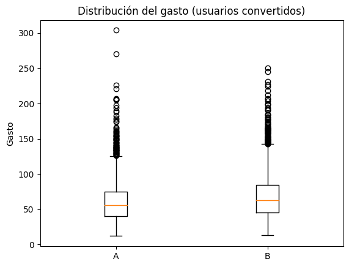
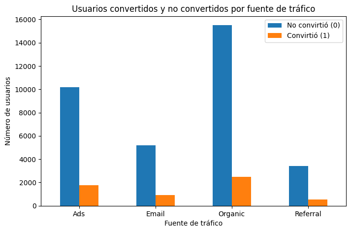
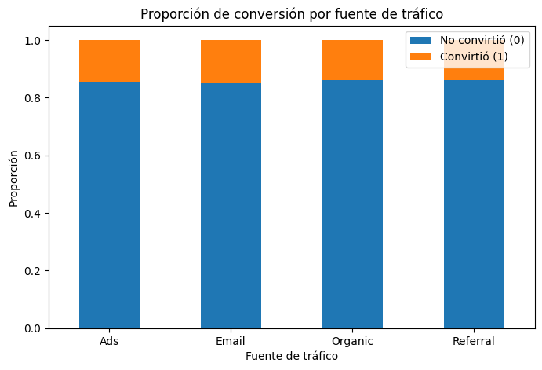
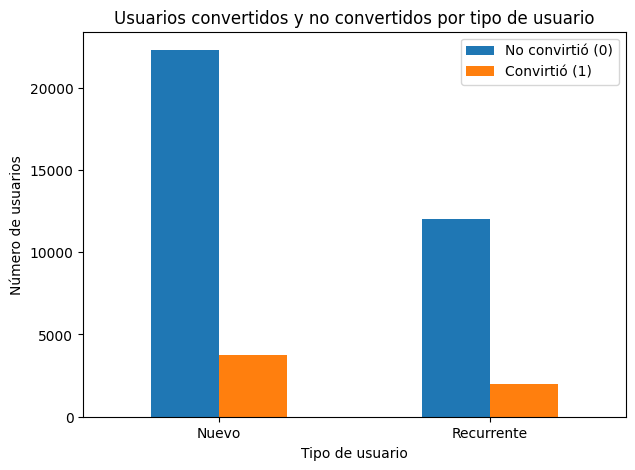
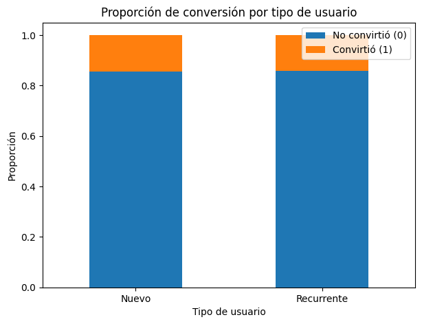

# 🧪 Experimento A/B en una landing page

Evaluación de un experimento A/B con **40,000 usuarios** expuestos a dos versiones de una página de inicio (A y B), para decidir con datos qué versión implementar.

**Herramientas:** Python · pandas · NumPy · SciPy · statsmodels · matplotlib · Jupyter

📓 **Notebook completo:** [`landing_experiment_ab_test.ipynb`](landing_experiment_ab_test.ipynb)

---

## Resumen ejecutivo

| Métrica | Página A | Página B | Diferencia | Prueba | Valor p |
|---|---|---|---|---|---|
| Tasa de conversión | 12.57% | **15.96%** | +3.4 pp (≈ +27% relativo) | Prueba z de proporciones | < 0.0001 |
| Gasto promedio por cliente | 61.09 | **68.75** | ≈ +12.5% | t de Welch | < 0.0001 |

**Recomendación: implementar la página B.** Convierte más visitantes en clientes **y** esos clientes gastan más por compra. Con un tráfico casi idéntico, B generó **682 compras más** que A.

---

## Pregunta de negocio

¿Qué versión de la landing page genera más valor? Y, de forma secundaria: ¿influyen la fuente de tráfico o el tipo de usuario en la conversión?

## Datos

`landing_experiment.csv`: 40,000 filas × 9 columnas, del 2026-01-01 al 2026-01-28 (4 semanas).

| Columna | Descripción |
|---|---|
| `user_id` | Identificador único del usuario |
| `date` | Fecha de exposición a la página |
| `landing` | Versión mostrada (A o B) |
| `region` | Región geográfica |
| `dispositivo` | Mobile / Desktop |
| `traffic_source` | Organic, Ads, Email, Referral |
| `user_type` | Nuevo / Recurrente |
| `converted` | 1 si el usuario compró |
| `gasto` | Monto gastado (0 si no convirtió) |

## Metodología

1. **Validación de datos y del experimento**
   - Sin nulos ni duplicados; 40,000 `user_id` únicos.
   - **Sin contaminación entre grupos:** ningún usuario fue expuesto a A y B.
   - Grupos balanceados (A = 19,982 · B = 20,018).
   - Regla de negocio verificada: `gasto > 0` solo cuando `converted = 1`. Por eso el gasto se compara únicamente entre usuarios convertidos.
2. **Gasto promedio (A vs B):** prueba de Levene para varianzas (p < 0.05 → varianzas distintas) y, en consecuencia, **t de Welch** (`equal_var=False`).
3. **Tasa de conversión (A vs B):** **prueba z para diferencia de proporciones** (`statsmodels`).
4. **Fuente de tráfico y tipo de usuario vs conversión:** **χ² de independencia**, verificando que todas las frecuencias esperadas sean ≥ 5.
5. **Visualización** de volúmenes absolutos y proporciones para respaldar cada prueba.

Nivel de significancia: α = 0.05 en todas las pruebas.

## Resultados

### 💰 Gasto por cliente
Los clientes de B gastan en promedio **68.75** contra **61.09** en A (t = −9.48, p < 0.0001).



### 🎯 Conversión
B convierte al **15.96%** contra **12.57%** de A (z = −9.68, p < 0.0001).

### 🌐 Fuente de tráfico
Asociación significativa pero débil (χ² = 8.66, gl = 3, p = 0.034).

| Canal | Conversión |
|---|---|
| Email | 14.99% |
| Ads | 14.74% |
| Referral | 13.88% |
| Organic | 13.79% |

Email y Ads son los canales más eficientes; Organic aporta el mayor volumen absoluto de conversiones (2,480) por ser el canal con más tráfico.

<p>
  
  
</p>

### 👤 Tipo de usuario
Sin diferencia significativa: nuevos **14.36%** vs recurrentes **14.09%** (χ² = 0.51, gl = 1, p = 0.474).

<p>
  
  
</p>

## Recomendaciones

- **Implementar la página B** para todo el tráfico: mejora la conversión y el gasto por cliente.
- **Priorizar inversión en Email y Ads**, los canales con mejor tasa de conversión, sin descuidar Organic por su volumen.
- **No crear experiencias diferenciadas** por tipo de usuario: nuevos y recurrentes convierten igual.

## Limitaciones y siguientes pasos

- El experimento duró solo 4 semanas, por lo que podría haber un **efecto novedad**; conviene monitorear las métricas tras la implementación.
- No se analizó si la ventaja de B se mantiene **dentro de cada canal, región o dispositivo**; sería el siguiente análisis para descartar efectos de composición.
- La columna `date` está como texto; para un análisis temporal (por ejemplo, conversión diaria por versión) habría que convertirla a `datetime`.

## Cómo ejecutarlo

```bash
pip install pandas numpy scipy statsmodels matplotlib jupyter
jupyter notebook landing_experiment_ab_test.ipynb
```

> El dataset proviene del programa de Data Analytics de TripleTen y no se incluye en este repositorio. El notebook lo lee desde `/datasets/landing_experiment.csv`; ajusta la ruta si lo ejecutas localmente.

---

👤 **Emmanuel Sánchez** · [LinkedIn](https://www.linkedin.com/in/emmanuel-sanchez-137452352/) · [Más proyectos](https://github.com/correonegocio1b-web)
